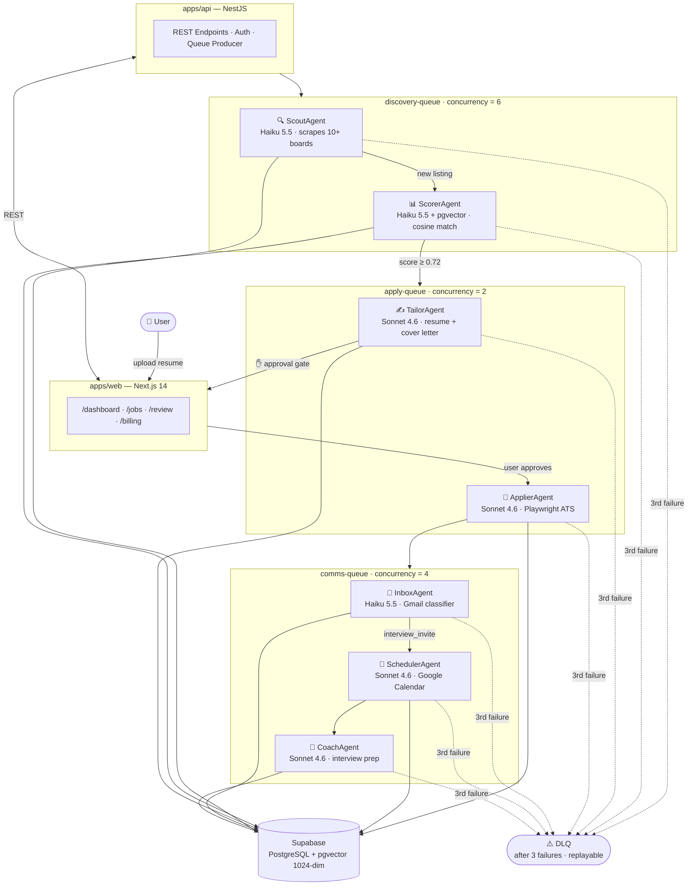

<p align="center">
  
</p>

<p align="center">
  
</p>

<p align="center"><em>Upload your resume once. PitchFire discovers matched jobs, tailors every application, submits autonomously, tracks replies, and books your interviews — all while you focus on the work that matters.</em></p>

<p align="center">
  <a href="https://app.netlify.com/projects/pitchfire/deploys"></a>
  <a href="https://github.com/jawadulhadi/pitchfire/actions/workflows/ci.yml"></a>
  <a href="#the-7-agents"></a>
  <a href="#tech-stack"></a>
  <a href="LICENSE"></a>
  <a href="SECURITY.md"></a>
  <a href="CHANGELOG.md"></a>
</p>

---

## What Makes PitchFire Different

Most job tools are search wrappers. PitchFire is a **multi-agent Claude orchestrator** where each agent owns exactly one domain, communicates exclusively via typed BullMQ queue messages, and plugs into your existing stack (Gmail, Google Calendar, Notion, Slack) — not third-party integrations bolted on later.

| Feature           | Others           | PitchFire                                                    |
| ----------------- | ---------------- | ------------------------------------------------------------ |
| Job discovery     | Manual or alerts | 10+ boards, continuous, Playwright stealth                   |
| Resume matching   | Keyword filter   | voyage-3-lite 1024-dim pgvector cosine similarity            |
| Resume tailoring  | Manual           | Claude Sonnet 4.6 + 2-round critique loop                    |
| Application       | Manual           | Autonomous Playwright ATS form-fill + user approval gate     |
| Reply tracking    | Check your inbox | Gmail tool-use loop, Haiku classifier, auto-update pipeline  |
| Interview booking | Manual           | Google Calendar REST API, confidence gate, Sonnet prep notes |
| Interview prep    | Manual research  | CoachAgent: role Q&A + company context via Claude Sonnet     |
| Failure handling  | Silent           | DLQ on 3rd failure, confidence gates, integrity checks       |

**Designing for AI Failure** is the core thesis: every autonomous action has a fallback (confidence < 0.8 → user flag), an approval gate (every application reviewed before submission), and a recovery path (DLQ replay). See [docs/RND.md](docs/RND.md) for the full reasoning.

---

## Architecture

The system has three tiers: a Next.js web app, a NestJS REST API that produces to a queue, and a long-running agent worker that consumes three typed BullMQ queues. All agents communicate through those queues — never via direct function calls.



**Monorepo layout** — npm workspaces + Turborepo:

```text
pitchfire/
├── apps/
│   ├── web/      Next.js 14 App Router (dashboard, review UI, billing)
│   ├── api/      NestJS REST API + BullMQ queue producer
│   └── agent/    Long-running worker — all 7 agents live here
└── packages/
    ├── resume-engine/     parse · voyage-3-lite embed · tailor
    ├── job-scraper/       Playwright stealth · RemoteOK · Wellfound
    ├── pipeline-tracker/  Supabase transitions · Notion sync stub
    └── shared/            Zod schemas · AgentJob discriminated union
```

---

## The 7 Agents

Each agent owns exactly one domain and outputs a typed BullMQ message consumed by the next in the chain.

| Agent              | Model                  | Trigger                  | Output                                 | Downstream                          |
| ------------------ | ---------------------- | ------------------------ | -------------------------------------- | ----------------------------------- |
| **ScoutAgent**     | Haiku 5.5              | cron / API               | Job listings stored in Supabase        | → ScorerAgent                       |
| **ScorerAgent**    | Haiku 5.5 + pgvector   | ScoutAgent               | Application rows with match score      | → TailorAgent (score ≥ 0.72)        |
| **TailorAgent**    | Sonnet 4.6             | ScorerAgent              | Tailored resume variant + cover letter | ⏸ approval gate                     |
| **ApplierAgent**   | Sonnet 4.6             | User approves in /review | ATS form filled + submitted            | → InboxAgent (5-min delay)          |
| **InboxAgent**     | Haiku 5.5              | ApplierAgent             | Email threads classified               | → SchedulerAgent (interview_invite) |
| **SchedulerAgent** | Haiku 5.5 + Sonnet 4.6 | InboxAgent               | Calendar event booked + prep notes     | → CoachAgent                        |
| **CoachAgent**     | Sonnet 4.6             | SchedulerAgent           | Role Q&A + company research            | — (final node)                      |

> **Approval gate**: TailorAgent deliberately stops the chain. Every application is reviewed by the user before it's submitted — `/review` is the human-in-the-loop checkpoint.

---

## Tech Stack

| Layer       | Technology                                   | Why                                                                           |
| ----------- | -------------------------------------------- | ----------------------------------------------------------------------------- |
| Frontend    | Next.js 14 App Router + Tailwind + shadcn/ui | SSR, free Netlify hosting                                                     |
| Backend API | NestJS + TypeScript                          | Decorators, modules, DI — structured for scale                                |
| AI Engine   | Claude Sonnet 4.6 / Haiku 5.5                | Model-per-task: Haiku for cheap classification, Sonnet for quality generation |
| Embeddings  | Voyage AI `voyage-3-lite` (1024-dim)         | $0.02/M tokens; semantically valid pgvector similarity                        |
| Database    | Supabase (PostgreSQL + pgvector)             | Vector similarity built-in, generous free tier                                |
| Queue       | BullMQ + Redis (Upstash)                     | 3 typed queues, DLQ, SIGTERM drain                                            |
| Browser     | Playwright                                   | Stealth headless ATS form-fill                                                |
| Email       | Gmail REST API                               | Claude tool-use loop for inbox monitoring                                     |
| Calendar    | Google Calendar REST API                     | Auto-book interview events + prep notes                                       |
| Tracking    | Supabase + Notion stub                       | DB for queries, Notion for human pipeline view                                |
| Monorepo    | npm workspaces + Turborepo                   | Parallel builds, shared packages                                              |

---

## Quick Start

**Prerequisites:** Node.js ≥ 22, Docker, an [Anthropic API key](https://console.anthropic.com)

```bash
# 1. Clone and install
git clone https://github.com/JawadulHadi/pitchfire.git
cd pitchfire
npm install

# 2. Configure environment
cp .env.example .env.local
# Required: ANTHROPIC_API_KEY, SUPABASE_URL, SUPABASE_ANON_KEY,
#           SUPABASE_SERVICE_ROLE_KEY, REDIS_URL
# Optional: VOYAGE_API_KEY (real embeddings), GMAIL_ACCESS_TOKEN,
#           GOOGLE_CALENDAR_ACCESS_TOKEN

# 3. Start local infrastructure
docker-compose up -d

# 4. Apply database migrations
npm run db:push

# 5. Start all services in parallel (web + api + agent worker)
npm run dev
```

Open [http://localhost:3000](http://localhost:3000) — Swagger UI at [http://localhost:3001/docs](http://localhost:3001/docs).

---

## Roadmap

| Phase | Goal | Status | PR |
| ----- | ------------------------------------------------------------ | ---------- | ----------------------------------------------------- |
| **1** | Foundation — Scout + Score + Dashboard | ✅ Complete | [#1](https://github.com/JawadulHadi/pitchfire/pull/1) |
| **2** | Apply Automation — Tailor + Playwright + Approval Gate | ✅ Complete | [#3](https://github.com/JawadulHadi/pitchfire/pull/3) |
| **3** | Communication Layer — InboxAgent + SchedulerAgent + 3 Queues | ✅ Complete | [#6](https://github.com/JawadulHadi/pitchfire/pull/6) |
| **4** | Intelligence & Polish — Analytics + CoachAgent + Bull Board | ✅ Complete | — |
| **5** | SaaS Layer — Stripe + Multi-tenant + Agency Mode | ✅ Complete | — |
| **6** | Agent Bus + Polish — Inter-agent comms + structured logging | ✅ Complete | — |

---

## Pricing

| Plan    | Price      | Limits                                                           |
| ------- | ---------- | ---------------------------------------------------------------- |
| Free    | $0/mo      | 10 applications/mo, 3 boards                                     |
| **Pro** | **$29/mo** | Unlimited applications, 15+ boards, AI tailoring, interview prep |
| Agency  | $99/mo     | 10 user profiles, white-label, bulk apply                        |

Break-even: **2 Pro subscribers ($58/mo) > $50/mo infra**. Profitable from user #2.

---

## Documentation

| Document                                     | Description                                                   |
| -------------------------------------------- | ------------------------------------------------------------- |
| [CHANGELOG.md](CHANGELOG.md)                 | Release notes — every change per version                      |
| [SECURITY.md](SECURITY.md)                   | Security policy, vulnerability reporting, credential guidance |
| [docs/RND.md](docs/RND.md)                   | **R&D findings** — what we researched, what we changed, why   |
| [docs/PROGRESS.md](docs/PROGRESS.md)         | Phase-by-phase implementation report with commit SHAs         |
| [docs/ARCHITECTURE.md](docs/ARCHITECTURE.md) | Agent data flow, DB schema, system design                     |
| [docs/API.md](docs/API.md)                   | REST API endpoint reference                                   |
| [docs/DEVELOPMENT.md](docs/DEVELOPMENT.md)   | Local setup, env vars, workspace scripts, testing             |
| [docs/DEPLOYMENT.md](docs/DEPLOYMENT.md)     | Cloud deployment: Netlify + Render + Supabase + Upstash       |
| [docs/ROADMAP.md](docs/ROADMAP.md)           | Phase-by-phase feature plan with deliverables                 |

---

## Contributing

Built by [Jawad Ul Hadi](https://github.com/JawadulHadi) — Backend Lead / AI Systems Architect.

**Let's connect**

<p>
  <a href="https://juh-bukhari.vercel.app"></a>
  <a href="https://juh-bukhari.vercel.app/resume.pdf"></a>
  <a href="https://juh-bukhari.vercel.app/case-study"></a>
  <a href="https://linkedin.com/in/jawad-ul-hadi"></a>
  <a href="https://gitlab.com/JawadulHadi"></a>
  <a href="https://stackoverflow.com/users/19086162/jawad-ul-hadi"></a>
  <a href="https://orcid.org/0009-0007-1317-4615"></a>
  <a href="https://calendly.com/jawadulhadicc"></a>
  <a href="https://mail.google.com/mail/?view=cm&fs=1&to=jawadulhadicc@gmail.com&su=Hello%20Jawad&body=Hi%20Jawad%2C%0A%0AI%20came%20across%20your%20profile." target="_blank"></a>
</p>

---

## License

MIT — see [LICENSE](LICENSE).
